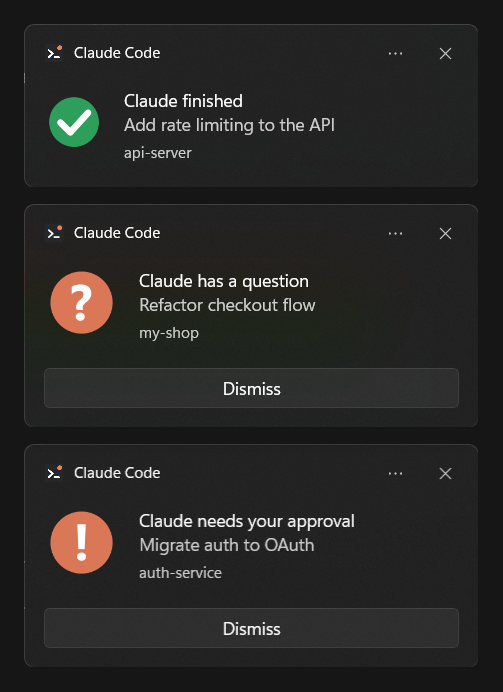

# Doorbell: Windows notifications for Claude Code

You give Claude a task, switch to another window while it works, and come back twenty minutes later to find it stopped after thirty seconds to ask a yes-or-no question. With three sessions open, you also have to work out which one was waiting.

Doorbell rings instead. The moment [Claude Code](https://code.claude.com) needs you, a Windows pop-up and a sound tell you which session is waiting, and when it finishes you get a chime and a short pop-up. Like a real doorbell, it rings when someone is waiting, and the pop-up stays until you answer. As a bonus, after you answer one of Claude's questions you get a recap of every option it offered, not just the one you picked.



## What's different

There are a few Windows notifiers for Claude Code. Doorbell is built around these:

- **A plugin, not a script to copy.** One line installs it, Claude Code's plugin manager updates it, and there is no `settings.json` to edit.
- **It tells you which session.** Each pop-up names the session (your `/rename` name, or Claude Code's own title), which matters when several are running at once.
- **Your prompts stay off the screen.** The question or command never appears in the pop-up or the notification center.
- **It rings until you answer, then stops.** Questions and approvals stay on screen while Claude waits and disappear the moment you respond in the terminal, whether you answer, approve or reject. Each session keeps at most one pop-up, so they never pile up.
- **Click to go there.** Clicking a pop-up brings up the terminal and selects that session's tab.
- **You see every option you were offered.** After you answer a question, a recap lists all of its options with your picks marked.
- **Nothing to install.** It runs on the PowerShell built into Windows, and the louder sounds are made on your machine from the standard Windows sounds.
- **No cost to Claude's context.** It is hooks only, so it adds nothing to what Claude reads (`claude plugin details` puts it at about 0 tokens per session).

## What you get

| When | Pop-up | Stays on screen | Sound |
| --- | --- | --- | --- |
| Claude asks you a question | orange **?** "Claude has a question" | until you respond | alert |
| Claude needs approval, or has a plan to review | orange **!** "Claude needs your approval" | until you respond | alert |
| Claude finishes its turn | green **✓** "Claude finished" | about 5 seconds | chime |

- **Which session, at a glance.** Under the title, the pop-up shows the session's name and, in small grey text, the folder or session handle.
- **Click to jump there.** In Windows Terminal, clicking a pop-up brings the window to the front and selects the session's tab. In other terminals (VS Code, the classic console) it brings up the window.
- **Louder sounds.** The standard Windows sounds, boosted by 14 dB by default. The boosted copies are made on your machine the first time they play, so no sound files ship with the plugin.
- **Question recap.** Claude Code normally keeps only "question → answer" once you reply. This adds every question with all of its options, your picks marked:

  ```
  ⎿  PostToolUse:AskUserQuestion says:

     [Payments] Which payment provider?
        ● Stripe - Cards and wallets
        ○ PayPal - Checkout redirect
        → Notes: fees matter

     [Regions] Which regions at launch? (multi-select)
        ● EU - VAT handling needed
        ○ US - Sales tax by state
        ● Indonesia - Rupiah, QRIS
  ```

  The recap is shown to you only; it is not sent to Claude.

## Background

This started as two sound hooks in my own Claude Code settings, so I'd hear when Claude finished or needed my approval while I was in another window. Sounds alone weren't enough to tell which session wanted me, or whether it was a question or just a finished turn, so they grew into these pop-ups, the louder sounds and the question recap, packaged here so anyone on Windows can install them in one line.

## Requirements

- Windows 10 or 11, with the built-in Windows PowerShell 5.1. Nothing else to install.
- A recent Claude Code with plugin support.
- Tested on Windows 11 23H2 with Claude Code 2.1.330.

## Install

At the Claude Code prompt:

```
/plugin install doorbell --marketplace davidalexander24/claude-code-doorbell
```

Answer `y` to add the marketplace, then pick a scope. From a shell instead:

```
claude plugin install doorbell --marketplace davidalexander24/claude-code-doorbell
```

If your Claude Code doesn't know `--marketplace` yet:

```
/plugin marketplace add davidalexander24/claude-code-doorbell
/plugin install doorbell@claude-code-doorbell
```

Then restart Claude Code (or run `/reload-plugins`) so the hooks load.

## Settings

Everything works out of the box. To change something, set environment variables in the `env` block of `~/.claude/settings.json`:

```json
{
  "env": {
    "CC_NOTIFY_GAIN_DB": "10",
    "CC_NOTIFY_DONE": "0"
  }
}
```

| Variable | Default | What it does |
| --- | --- | --- |
| `CC_NOTIFY_GAIN_DB` | `14` | Volume boost for the sounds, in decibels. `0` plays them unchanged. |
| `CC_NOTIFY_SOUND` | `1` | `0` turns all sounds off. |
| `CC_NOTIFY_DONE` | `1` | `0` turns off the "Claude finished" pop-up and chime. |
| `CC_NOTIFY_PERSIST` | `1` | `0` lets question and approval pop-ups time out (about 25 seconds) instead of waiting for you. |
| `CC_NOTIFY_AUTOCLEAR` | `1` | `0` keeps question and approval pop-ups up after you respond, until you dismiss them or the turn ends. |
| `CC_NOTIFY_CLICK` | `1` | `0` turns off jumping to the session when you click a pop-up. |
| `CC_NOTIFY_RECAP` | `1` | `0` turns off the question recap. |
| `CC_NOTIFY_ATTENTION_SOUND` | `Windows Error.wav` | Path to your own `.wav` for questions and approvals. |
| `CC_NOTIFY_DONE_SOUND` | `Windows Notify.wav` | Path to your own `.wav` for finished turns. |
| `CC_NOTIFY_APP_NAME` | `Claude Code` | The name shown in the pop-up's header. |
| `CC_NOTIFY_DEBUG` | `0` | `1` logs what the pop-up watcher sees to `notify.log`, for troubleshooting. |

Custom sounds are boosted too when they are 16-bit PCM WAV files; any other format plays as it is.

## How it works

The plugin adds three hooks, all running [`scripts/notify.ps1`](scripts/notify.ps1):

| Hook | Fires when | Does |
| --- | --- | --- |
| `PermissionRequest` | Claude is about to ask for approval, asks a question (`AskUserQuestion`) or presents a plan (`ExitPlanMode`) | question or approval pop-up and alert sound, then watches for your response |
| `Stop` | Claude finishes its turn | "finished" pop-up, chime |
| `PostToolUse` on `AskUserQuestion` | you answered a question | clears the question pop-up, prints the recap |

Pop-ups use the Windows notification API through PowerShell's WinRT support, under an app identity registered at `HKCU\Software\Classes\AppUserModelId\ClaudeCodeDoorbell`. Boosted sounds, a copy of the icons and the click handler are kept in `%LOCALAPPDATA%\claude-code-doorbell`, along with `notify.log` if anything goes wrong.

**Clearing when you respond.** Claude Code marks a session as `waiting` in `~/.claude/sessions` while a question or approval is open, and as busy again once you respond. After showing a question or approval pop-up, the hook keeps running in the background, checks that status a few times a second, and removes the pop-up as soon as the session stops waiting.

**Click to jump there.** When the hook runs, it follows Claude Code's console to the window that shows it (with Windows Terminal, the pseudo-console window is owned by the terminal window that hosts the tab) and puts that window and the session title into the pop-up's click action, a `doorbell:` link registered at `HKCU\Software\Classes\doorbell`. Clicking runs [`scripts/focus.ps1`](scripts/focus.ps1), which selects the tab with that title through UI Automation and brings the window to the front. The few Win32 calls this needs are in [`scripts/native.cs`](scripts/native.cs), compiled once on your machine.

The session name and status come from the session's transcript and from `~/.claude/sessions`. These are Claude Code's internal files and may change between versions; if the name can't be found, the pop-up shows the folder name instead, and if the status can't be read, the pop-up clears when the turn ends.

## Limitations

- **Windows only.**
- **Do Not Disturb hides the banners.** With Do Not Disturb or Focus on, or Windows' automatic rules (for example while a game or full-screen app runs), notifications go straight to the notification center without popping up.
- **The recap has a label you can't remove.** Claude Code puts `PostToolUse:AskUserQuestion says:` in front of anything a hook prints, and hooks can't hide it ([#99048](https://github.com/anthropics/claude-code/issues/99048)). Showing all options natively is requested in [#111703](https://github.com/anthropics/claude-code/issues/111703).
- **Jumping to the tab goes by its title.** If two tabs have the same title, or your shell renames its tabs, a click brings up the window without switching tabs. Windows also sometimes refuses to let a program take focus, in which case the terminal's taskbar button flashes instead.
- **No notifications in `claude -p`.** Background hooks are cancelled when a print-mode session exits.
- **Duplicate browser notifications.** If you use Remote Control and have claude.ai open in a browser, claude.ai may send its own notifications too. Block notifications for claude.ai in that browser if you only want these.

## Troubleshooting

No pop-up at all:

1. Check **Settings → System → Notifications**: notifications on, **Claude Code** allowed, Do Not Disturb off.
2. Look in `%LOCALAPPDATA%\claude-code-doorbell\notify.log`.
3. From a clone of this repo, fire one by hand:

   ```powershell
   '{"tool_name":"AskUserQuestion","cwd":"C:\\dev\\demo"}' | powershell -NoProfile -ExecutionPolicy Bypass -File .\scripts\notify.ps1 -Kind attention
   ```

## Uninstall

```
claude plugin uninstall doorbell
```

To also remove the cached files, the app identity and the `doorbell:` link:

```powershell
Remove-Item -Recurse "$env:LOCALAPPDATA\claude-code-doorbell"
Remove-Item "HKCU:\Software\Classes\AppUserModelId\ClaudeCodeDoorbell"
Remove-Item -Recurse "HKCU:\Software\Classes\doorbell"
```

## License

[MIT](LICENSE). An unofficial community plugin, not affiliated with or endorsed by Anthropic. Claude and Claude Code are trademarks of Anthropic.
